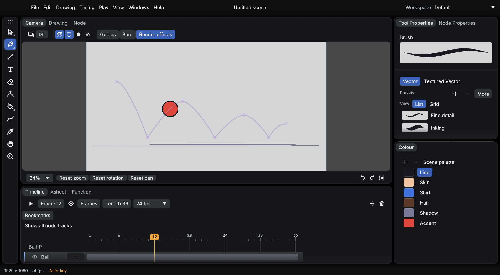

# Symphony

Symphony is a free, open-source 2D animation app for drawing, timing, and
node-based compositing.

[Presentation page](https://tdemers218.github.io/symphony/) ·
[Preview builds](https://github.com/tdemers218/symphony/releases)



## Key features on the development branch

- **Turn brush tips into editable vectors.** Bring in brushes from Photoshop, Krita, Procreate, and more. Trace imported brush tips into editable outlines you can reshape and recolour. Editable strokes retain supported pen input, including pressure, tilt, and barrel rotation.
- **Bend a line as you draw.** Hold Alt while drawing with the Line tool to bend the stroke between its endpoints. Hold Shift to snap the angle in 22.5° steps.
- **Recolour drawings from one swatch.** Edit a scene palette colour once and every stroke or fill linked to it updates together.
- **Stage a multiplane camera move.** Set depth on drawing pegs and animate the camera for parallax. Maintain Size keeps the drawing in place while you set its depth.
- **Position artwork with effects paused.** Switch off Render effects while positioning artwork in Camera. Turn off Bars to see artwork outside the frame while keeping exports framed.
- **Resume an interrupted export.** Restart the same export to reuse finished frames after a crash or cancellation. This works for movies, GIFs, and image sequences.
- **Untangle a node graph.** Arrange Nodes lays out the graph by signal flow. Select a node to highlight its cables and ports, or drag it to make nearby cards slide out of the way.
- **Make room for in-betweens.** Insert frames after the playhead. Current exposures hold through the gap, and later exposures and peg keys shift together.
- **Choose a separate movie frame rate.** Animate at your scene’s frame rate and choose a different rate for the movie export. Symphony resamples the timing to keep the shot’s duration.
- **Turn a drawing into an editable matte.** Switch a drawing to a mask and back while keeping its artwork, exposures, and node connections.
- **Find actions with Tab Search.** Type what you want to do. Results prioritize the panel you’re working in, from adding an effect to running a timing command.

Not affiliated with Toon Boom. Built clean-room from public documentation
(see [docs/CLEAN-ROOM.md](docs/CLEAN-ROOM.md)).

- **[Plan: status, what's left, full feature list](docs/PLAN.md)**
- **[Design rules](docs/DESIGN.md)** and **[engineering rules](docs/ENGINEERING.md)**: every change follows these.
- [Research](docs/RESEARCH.md) · [Language choice](docs/LANGUAGE.md) · [Roadmap](docs/ROADMAP.md) · [Tablets](docs/TABLETS.md)
- [AI in Symphony](docs/AI-POLICY.md): no generative AI, ever.
- [Codecs](docs/CODECS.md): movie export uses Cisco's OpenH264, downloaded only when you ask.
- [Testing Symphony](docs/TESTERS.md): install the launcher.
- [Contributing](CONTRIBUTING.md): please read the clean-room rules first.

Licensed under GPL-3.0-or-later.

## Build
```sh
cargo test
cargo run --release -p symphony-pentest   # pen test window
```

## Layout
- `crates/symphony-core`: scene model (xsheet, node graph, pegs, evaluation).
  No UI.
- `crates/symphony-pen`: our own pen/tablet input layer (pressure, tilt,
  rotation, eraser), one backend per OS. macOS done; Windows and Linux next.
- `crates/symphony-pentest`: test window that draws with pressure and logs
  every sample to `target/pen-log.csv`.
